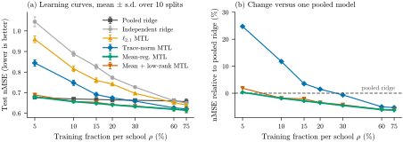

# Shrink Towards the Mean, Not Towards Zero

Code, results and paper for **"Shrink Towards the Mean, Not Towards Zero: Revisiting Pooling Baselines for Regularized Multi-Task Learning on the School Benchmark"** (Devangan Mukherjee, 2026).

Regularized multi-task learning (MTL) is usually compared with independent per-task models. On the School benchmark (139 schools, 15,362 students), this repository compares six linear estimators across training fractions from 5% to 75% of each school:

* trace-norm and l2,1 MTL beat independent ridge on every split, but a **single pooled ridge model beats trace-norm MTL on every split up to 20%**, because those penalties shrink every school towards zero;
* **mean-regularized MTL**, which shrinks each school towards a learned shared model, stays within 0.4% of pooled ridge at 5% and is the best or tied-best method from 10% onwards;
* a fixed iteration budget fails silently on unscaled features, and two common definitions of explained variance differ by 11 to 13 points for identical predictions.



## Results

Test nMSE (mean over 10 random splits, lower is better; best in bold). Produced by `experiments/make_tables.py`, see Table 2 of the paper for standard deviations and Table 3 for paired tests.

| Method | 5% | 10% | 15% | 20% | 30% | 60% | 75% |
|---|---:|---:|---:|---:|---:|---:|---:|
| pooled ridge | **0.677** | 0.669 | 0.667 | 0.665 | 0.663 | 0.660 | 0.656 |
| independent ridge | 1.045 | 0.889 | 0.826 | 0.773 | 0.727 | 0.660 | 0.649 |
| l2,1 MTL | 0.959 | 0.816 | 0.760 | 0.741 | 0.697 | 0.652 | 0.640 |
| trace-norm MTL | 0.844 | 0.748 | 0.691 | 0.675 | 0.659 | 0.626 | 0.621 |
| mean-reg MTL | 0.679 | **0.657** | **0.648** | **0.641** | **0.633** | 0.620 | **0.615** |
| mean+low-rank MTL | 0.689 | 0.657 | 0.653 | 0.641 | 0.635 | **0.619** | 0.616 |

As a sanity check, the trace-norm model reproduces the published School result of Argyriou et al. (2008): 26.5% explained variance against 26.7% reported.

## Quick start

Requires Python 3.9 or newer. Download or clone this repository, then from its root folder:

```bash
python -m venv .venv
# Windows PowerShell:  .venv\Scripts\Activate.ps1      Linux / macOS:  source .venv/bin/activate
pip install -r requirements.txt

python -m pytest -q                 # 16 offline unit tests, about 2 s
python run_all.py --quick           # smoke test: 2 splits x 3 fractions, checked against the paper, a few minutes
python run_all.py                   # full reproduction, about 25 min on 2 CPU cores
python run_all.py --from-reference  # skip the experiments, rebuild figures and tables from the stored results
```

`run_all.py` works the same on Windows, macOS and Linux. On Linux and macOS the `Makefile` offers the same steps (`make test`, `make quick`, `make`, `make paper`).

## What `run_all.py` does

| Step | Script | Output |
|---|---|---|
| 1. Download School data, check SHA-256 | `scripts/download_data.py` | `data/school.mat` |
| 2. Benchmark: 6 methods x 7 fractions x 10 splits, 5-fold CV | `experiments/run_benchmark.py` | `results/raw/benchmark.json` |
| 3. Optimisation experiment (ISTA vs FISTA, raw vs standardised) | `experiments/run_optimisation.py` | `results/raw/optimisation.json` |
| 4. Statistics: summaries, paired tests, per-school gains, structure | `experiments/analyse.py` | `results/analysis.json` |
| 5. Figures (SVG and PDF) | `experiments/make_figures.py` | `figures/` |
| 6. LaTeX tables | `experiments/make_tables.py` | `paper/tables/` |
| 7. Compare every number with the paper | `experiments/verify.py` | pass / fail report |

Every number in the paper comes from `results/analysis.json`; no table entry is typed by hand.

## Reproducibility

* **Exact rerun.** All randomness is seeded: split `s` uses `numpy.random.default_rng(10000 + s)`, and cross-validation on that split uses `default_rng(20000 + s)` for every method, so all methods see the same folds. A full rerun of this repository matched the stored paper results exactly (maximum relative difference 0); `experiments/verify.py` checks this for you. Other BLAS libraries or CPUs can change results in the last few digits; use `python experiments/verify.py --tol 1e-6` in that case.
* **Stored results.** `results/reference/` holds the raw results behind the paper, so figures and tables can be rebuilt without rerunning anything.
* **Data.** The School data is distributed with [MALSAR](https://github.com/jiayuzhou/MALSAR) under the GPL-2.0, so it is downloaded rather than included; see `data/README.md`.
* **Environment.** Results were produced with Python 3.13, NumPy 2.5.3, SciPy 1.18.1 and Matplotlib 3.11.2 on 2 CPU cores. Only NumPy and SciPy are needed for the experiments.

## Using the estimators

```python
import numpy as np
from mtlpool import load_school, make_split, unzip, mean_regularized, cv_select, metrics, GRIDS

Xs, ys = load_school("data/school.mat")
train, test = make_split(Xs, ys, ratio=0.2, s=0, seed_base=10_000)
Xtr, ytr = unzip(train)

lam, _ = cv_select(mean_regularized, GRIDS["mean-reg MTL"], train, np.random.default_rng(20_000))
W = mean_regularized(Xtr, ytr, lam)          # d x t matrix, one column per school
print(metrics(W, test, np.concatenate(ytr))["nmse"])
```

Every estimator has the signature `fit(Xs, ys, hyperparameter) -> W`, where `Xs` and `ys` are lists with one design matrix and one target vector per task.

| Estimator | Objective | Solver |
|---|---|---|
| `pooled_ridge` | one ridge model for all tasks | closed form |
| `independent_ridge` | one ridge model per task | closed form |
| `l21_mtl` | L(W) + λ‖W‖₂,₁ | FISTA, 500 iterations |
| `trace_mtl` | L(W) + λ‖W‖* | FISTA, 500 iterations |
| `mean_regularized` | W = b1ᵀ + V, L(W) + (λ/2)‖V‖²_F | exact linear solve |
| `mean_lowrank` | W = b1ᵀ + V, L(W) + λ‖V‖* | FISTA on V with exact b |

Here L(W) = Σᵢ (1/2nᵢ)‖Xᵢwᵢ − yᵢ‖², so every school counts equally in the loss.

## Repository layout

```
src/mtlpool/        the package: data handling, proximal operators and FISTA, estimators, CV, metrics
experiments/        one script per step of the pipeline (see the table above)
scripts/            data download with checksum
tests/              offline unit tests on synthetic data
results/reference/  stored results behind the paper (a fresh run writes to results/raw/, not tracked by git)
figures/            the five paper figures as SVG and PDF
paper/              LaTeX source and compiled PDF (build with: cd paper && latexmk -pdf main.tex)
run_all.py          the whole pipeline in one command
```

## Citation

If you use this code, please cite the report (see `CITATION.cff`):

```bibtex
@misc{mukherjee2026shrink,
  title  = {Shrink Towards the Mean, Not Towards Zero: Revisiting Pooling Baselines for Regularized Multi-Task Learning on the School Benchmark},
  author = {Mukherjee, Devangan},
  year   = {2026},
  note   = {Preprint}
}
```

## License

Code: MIT (see `LICENSE`). Paper and figures: CC BY 4.0. The School data is not included and keeps its original license.

## Acknowledgements

The School data is from the Inner London Education Authority, as distributed by MALSAR.
